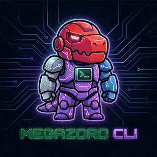
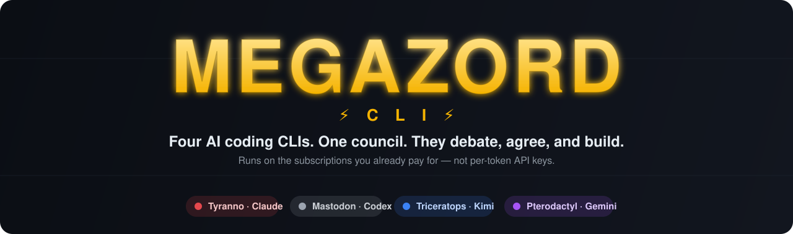
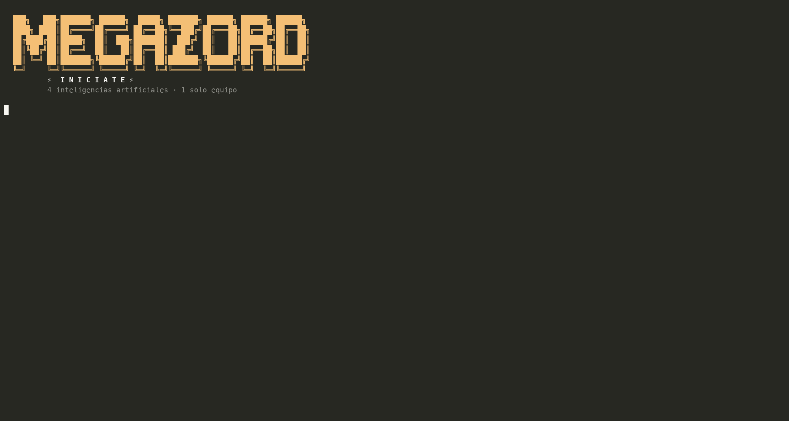

<div align="center">





<br><br>

[](LICENSE)
[](package.json)

[](CONTRIBUTING.md)
[](https://github.com/enpixeles-ai/megazord-cli)

**Megazord convenes Claude, Codex, Kimi and Gemini** as a team: they each analyze your task, critique each other's proposals, reach a single arbitrated directive, and then **split the work by strength and build it** — with automatic verification gates.

It runs on the **CLI subscriptions you already pay for** — not per-token API keys.

```bash
megazord "how do I make this API 3x faster without breaking auth?"     # debate → directive
megazord mission "add rate limiting to the login endpoint"             # debate → plan → BUILD
```

[Quick start](#-quick-start) · [How it works](#-how-it-works) · [Commands](#-commands) · [FAQ](#-faq)

</div>

---

## 🎬 See it in action

<div align="center">

<!-- 👉 Replace with your GIF: record with `asciinema rec demo.cast -c megazord-iniciate` then `agg demo.cast assets/demo.gif` -->


<i>A stylized intro animation of the flow: the Zords assemble, debate, split the work by strength, and build.</i>

</div>

---

## Why

One AI is one opinion. Ask four strong models the same coding question and you get something better than any of them alone: a **debate**. One catches the bug another missed. One over-engineers, another simplifies. A referee (Claude, the architect) synthesizes the best of each into a single plan — then the four **build it in parallel**, each doing what it's best at.

Most multi-agent tools bill you per token through APIs. **Megazord shells out to the CLIs you're already logged into** (Claude Code, Codex CLI, Kimi CLI, Gemini CLI). If you pay flat monthly subscriptions, your marginal cost per council is effectively **$0**.

## The Zords

| Zord | CLI | Plays to its strength |
|------|-----|------------------------|
| 🦖 **Tyranno** | Claude | Architect & referee — synthesizes the directive, owns critical/production code, final integration |
| 🐘 **Mastodon** | Codex | Surgical editor — precise refactors, tests, single-file fixes |
| 🛡️ **Triceratops** | Kimi | Workhorse — volume, scaffolding, new files, migrations |
| 🦅 **Pterodactyl** | Gemini | Recon — research, QA, docs, end-to-end tests |

## 🚀 Quick start

### 1. Install the CLIs you want as Zords

Megazord orchestrates existing CLIs — install and log into the ones you have:

```bash
npm i -g @anthropic-ai/claude-code   # 🦖 Claude  (required — it's the referee)
npm i -g @openai/codex               # 🐘 Codex   (optional)
npm i -g @moonshot-ai/kimi-code      # 🛡️ Kimi    (optional)
npm i -g @google/gemini-cli          # 🦅 Gemini  (optional)
```

Then log into each one once (`claude`, `codex`, `kimi login`, `gemini`). Megazord works with **as few as 2** — it adapts to whoever is available.

### 2. Install Megazord

```bash
npm i -g megazord-cli
# or from source:
git clone https://github.com/enpixeles-ai/megazord-cli && cd megazord-cli && ./install.sh
```

### 3. Check your roster

```bash
megazord            # 🦖 roll call — shows which Zords are online
```

### 4. Use it

```bash
cd your-project

megazord "should I use a queue or a cron for this?"   # the council debates, gives you one answer
megazord mission "add input validation to the signup form"   # debate → plan → build → verify
```

## 🧠 How it works

```
        you: a task
          │
          ▼
   ┌──────────────────────────────────────────────┐
   │  ROUND 1  — each Zord proposes independently   │
   │  ROUND 2  — each Zord critiques the others     │
   │  ARBITER  — Claude synthesizes ONE directive   │
   │             + a JSON plan (who builds what)    │
   └──────────────────────────────────────────────┘
          │
          ▼  (only with `mission` / `execute --approve`)
   ┌──────────────────────────────────────────────┐
   │  BUILD  — steps run in parallel by owner       │
   │           each step self-verifies (test/lint)  │
   │           file-disjoint steps run concurrently  │
   └──────────────────────────────────────────────┘
          │
          ▼
   a transcript you can audit + optional Telegram recap
```

- **Debating is read-only.** Nothing touches your files until you say `mission` or `execute --approve`.
- **Every build step runs a real verify command** (test/lint/compile) from an allow-list — no shell injection, no `rm`.
- **Parallel by design.** Steps that touch different files run at the same time.
- **Every session is logged** to `.council-dev/runs/` — a receipt of who said what and who built what.

## 📋 Commands

| Command | What it does |
|---------|--------------|
| `megazord` | Roll call — which Zords are online |
| `megazord "<question>"` | The council debates and gives you one directive (read-only) |
| `megazord plan "<task>"` | Debate and **propose** a work split for you to approve |
| `megazord approve` | Execute the last proposed plan as-is |
| `megazord mission "<task>"` | Debate → plan → **build in parallel** |
| `megazord review` | The Zords review your current `git diff` |
| `megazord session` | Read the "minutes" of the last council (who said what) |
| `megazord cost` | Token usage of the last session |
| `megazord doctor` | Diagnose which CLIs are installed and authenticated |

Under the hood everything is the `council-dev` engine — `megazord` is a friendly wrapper. Run `council-dev --help` for the raw interface.

## 🎬 Extras

- **`megazord-chamber`** — a live 2×2 "Power Chamber" that shows each Zord working in its own pane.
- **`megazord-iniciate`** — a cinematic ASCII intro animation of the Zords forming up. A fun splash screen for demos and streams.

## ❓ FAQ

**Do I need all four CLIs?** No. Two is enough. Claude is the referee, so it's recommended, but Megazord adapts to whoever's online.

**Does this cost money per run?** Only what your subscriptions already cost. Megazord doesn't use API keys — it drives CLIs you're logged into. Run `megazord cost` to see the token magnitude (reference only).

**Is it safe? Can it wreck my repo?** Debating never touches files. Building only runs with explicit approval, one verify command per step (from a safe allow-list), and everything is logged. Use `git` and you can revert any run.

**Which OS?** macOS and Linux (the underlying CLIs target those). Node 18+.

**Can I add another model?** Yes — the adapter layer is small. PRs welcome.

## 🤝 Contributing

Issues and PRs welcome — see [CONTRIBUTING.md](CONTRIBUTING.md). The engine is a single dependency-free Node file (`bin/council-dev.js`), so it's easy to read and hack.

## ⚖️ Disclaimer

Megazord is an independent, unofficial **fan project**. It is **not affiliated with, endorsed by, or connected to Hasbro, Saban, or the Power Rangers franchise** in any way. "Megazord", "Power Rangers" and the Zord names are trademarks of their respective owners and are used here only as an affectionate nod. No infringement is intended.

## 📄 License

MIT © 2026 Manuel Peña ([EnPíxeles](https://enpixeles.net)). See [LICENSE](LICENSE).

<div align="center">
<br>
<b>🦖 Four AIs. Zero drama. Go go Megazord.</b>
</div>
